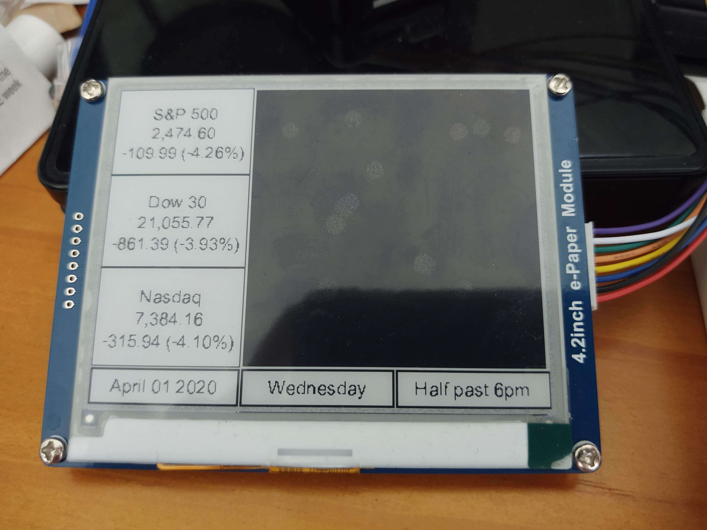

# e-ink-display

This is a project I put together so that I can display images on my [4.2inch e-Paper Module](https://www.waveshare.com/wiki/4.2inch_e-Paper_Module).

I figured that it would be nice to be able to send in images from any source so that if I decide I want to send in images in a different way in the future it would not be hard to change.

So, there are 3 main pieces to this project:

1. client/client-file-transfer
    - simple express api that accepts images via a post request
    - this will run on the raspberry pi zero I have connected to my e-Paper module
2. client/python-display
    - cloned and modified from [waveshare/e-Paper](https://github.com/waveshare/e-Paper))
    - this will also run on the raspberry pi zero I have connected to my e-Paper module
3. server
    - application that will generate bitmap images every minute or two to send to the client in order to be displayed on the e-ink display
    - this can run on any computer on the same network as the e-Paper module

## Running with Docker

`./run.ps1` (PowerShell) or `./run.sh` (bash) builds and starts the server and the client-file-transfer API with Docker Compose, picks a free host port and prints the client URL. The server posts each image to the client container. To drive the real display, set `CLIENT_URL` in `.env` to the Pi's address (see `.env.example`). `./run.ps1 down` stops the stack.

